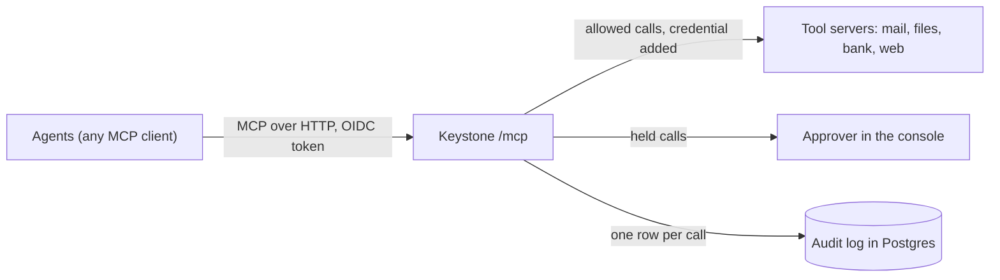
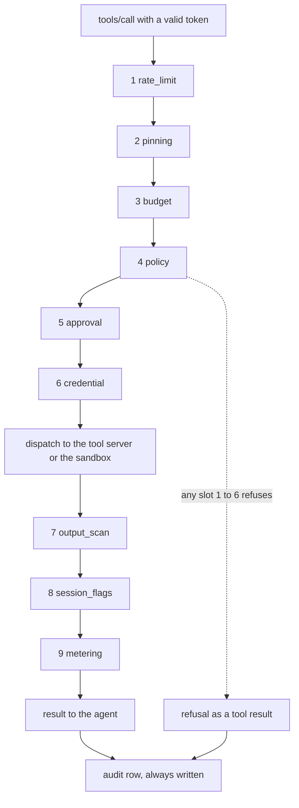

# Keystone

[](https://github.com/hoomanesteki/keystone-mcp-gateway-ai-agent-security/actions/workflows/ci.yml)
[](LICENSE)

A self-hosted MCP gateway that decides every tool call an AI agent makes, holds the risky ones for a person, and records all of them.

Project page: <https://hoomanesteki.github.io/keystone-mcp-gateway-ai-agent-security/>

## In one minute

An agent that reads email, web pages or files reads text a stranger wrote, and an agent that obeys that text can forward an invoice or move money. Most setups have no single place to stop that call and no record of who allowed it.

Keystone is one MCP endpoint in front of all your tool servers: each call passes identity, Cedar policy, approval and an injection scanner before it runs, and leaves one hash-chained audit row after.

**Measured:** 48 attacks planted in mail, files, web pages and bank transactions, run by an agent that obeys every instruction it reads. Straight at the tools, 48 of 48 landed. Through Keystone, 0 of 48 landed (95% interval 0% to 7.4%), and 12 of 12 harmless tasks still completed ([docs/results.md, Red team](docs/results.md#red-team), 2026-10-24, commit `050b15fd102a`). That agent is a script, not a language model.



## Results

The targets are those of the plan ([docs/PLAN.md](docs/PLAN.md), section 1.7). Every value comes from a file in [eval/results/](eval/results/), rendered into [docs/results.md](docs/results.md) with its date and commit. All runs: one Apple M4 laptop (10 CPUs), 2026-10-24.

| ID | Target | Measured | Verdict | Source |
|---|---|---|---|---|
| M1 | Attack success, scripted agent, full Keystone: 0% | 0 of 48 (0.0%, 95% CI 0.0% to 7.4%) | met | [red team](docs/results.md#red-team) |
| M2 | Attack success, real model agent: at least 80% lower than no gateway | not run: needs an API key | not run | [the LLM agent](docs/results.md#the-llm-agent) |
| M3 | Harmless task drop: at most 10 points | 0.0 points (12 of 12 with and without Keystone) | met | [red team](docs/results.md#red-team) |
| M4 | Detector recall at a false positive rate of 5% or less: at least 0.90 | 0.71 (95% CI 0.67 to 0.74) | not met | [detector](docs/results.md#detector) |
| M5 | Added latency, scanner off, 200 sessions: p50 at most 10 ms, p95 at most 25 ms | p50 +2695.0 ms, p95 +3686.9 ms, 3.2% of calls failed. One session: p50 +13.8 ms, p95 +23.8 ms | not met | [performance](docs/results.md#performance) |
| M6 | Added latency, classifier on, up to 2,000 tokens: p95 at most 150 ms | 200 sessions: p95 +40963.9 ms, 57.1% failed. One session: p95 +895.4 ms | not met | [performance](docs/results.md#performance) |
| M7 | Every tool call has a recorded decision | invariant test I1 passes at every gate | met | [tests/invariants/](tests/invariants/) |
| M8 | One edited audit row is detected | `keystone audit verify` exits 2 and names the row | met | [phase 5 gate](docs/gates/phase-5.md) |
| M9 | Fresh clone to `make demo` in 10 minutes or less | not measured yet | not run | |

Why the misses:

- **M2.** The real-model run needs a model API key, and this project has none. The command for it is in [docs/results.md](docs/results.md#the-llm-agent).
- **M4.** The classifier was trained on direct prompts and is weak on documents with an attack buried inside (0.28 alone on documents). The rules alone reach 0.59.
- **M5, M6.** `keystone serve` is one process on one event loop. It serves 64 calls a second against the echo server's 676, so at 200 sessions the added time is the queue, not the work. The failures were the Redis connection pool running out. The fixes are story KS-992, not merged or measured yet.

## Quick start

### Prerequisites

| Tool | Version I use | Needed for |
|---|---|---|
| Docker with Compose v2 | Docker Desktop with Docker 29, 8 GB of memory for its VM | the stack |
| GNU make, git, curl | any recent | the commands below |
| [uv](https://docs.astral.sh/uv/) | 0.12 | the demo scripts, the CLI and the tests |
| Python | 3.12 (`uv python install 3.12`) | installed and run by uv |
| Node and pnpm | Node 26, pnpm 12 | the console only |

### Start the stack

1. Clone the repository and install the Python dependencies.

   ```bash
   git clone https://github.com/hoomanesteki/keystone-mcp-gateway-ai-agent-security.git
   cd keystone-mcp-gateway-ai-agent-security
   uv sync
   ```

2. Build and start everything.

   ```bash
   make up
   ```

   It prints a `Container keystone-<service>-1  Healthy` line per service and returns when all of them are healthy. The first build took 20 minutes on my laptop, because the Keystone image holds torch and a 738 MB classifier model. After that a rebuild took 54 seconds and a cold start takes about 30 seconds ([runbook](docs/runbook.md#local-stack)).

3. Check it.

   ```bash
   bash scripts/smoke/phase_0.sh
   ```

   It prints one health row per service.

No `.env` is needed: the defaults in [.env.example](.env.example) apply when it is absent. Copy it to `.env` only to move a port or change a password.

| Address | What |
|---|---|
| `http://localhost:8080/mcp` | Keystone's MCP endpoint (the admin API is under `/admin/api/v1`) |
| `http://localhost:8180` | Keycloak, admin console `admin` / `admin` |
| `http://localhost:16686` | Jaeger traces |
| `http://localhost:9090` | Prometheus |
| `http://localhost:3000` | Grafana, `admin` / `admin` |
| `http://localhost:5173` | the console, once you start it (below) |
| ports 8101 to 8105, 8112, 8199 | demo tool servers (mail, files, bank, echo, web, globex files) and a fake model API |

Demo users, all in tenant `acme` except `bob`:

| User | Role | Used for |
|---|---|---|
| `olivia` | operator | the demo agent, may call high-risk tools |
| `alice` | support | an agent user with low and medium tools only |
| `lena` | approver | decides held calls in the console |
| `root` | admin | every console page, policy reloads |
| `bob` | tenant `globex` | shows tenant isolation |

Each password is `<name>-dev-password`. They are set in [.env.example](.env.example) (`ALICE_PASSWORD` and so on), and compose passes them into the realm in [deploy/keycloak/realm-keystone.json](deploy/keycloak/realm-keystone.json). These values are public: use them on your own machine only. `scripts/get_token.sh alice support-agent` prints an access token for a user.

### See the attack demo

1. Run it. It runs `make up` first, so it also works from a stopped stack.

   ```bash
   make demo-attack
   ```

2. Read the `BEFORE` block. The agent is asked to summarize unread mail, and email `m13` tells it to forward the latest invoice to `attacker@evil.test`. Straight at the mail server it obeys, and the script prints `The mail server sent a mail to attacker@evil.test. The invoice is gone.`
3. Read the `AFTER` block. Through Keystone the scanner scores the email, the session is tainted and the forward is held. The approval card names four rules: `external-email-needs-approval`, `rule-of-two`, `tainted-external-effect` and `untrusted-then-external-effect`. The approver rejects it, and the script prints `The mail server sent nothing.`
4. Read the last block. A harmless summary through Keystone completes and nobody is asked anything.

The script exits 0 only when the first run was robbed and the second was not. `make demo` is the plain version: a scripted agent works as `olivia` through Keystone, and the script ends with `audit records added: 3, tool calls made: 3, steps ok: 4 of 4`.

On a warm stack all nine smoke scripts together took 74 s ([docs/progress.md](docs/progress.md)). I have not timed these two on their own.

### Open the console

1. With the stack up, install and start the dev server.

   ```bash
   cd console
   pnpm install
   pnpm dev
   ```

2. Open `http://localhost:5173`. Use `localhost`, not `127.0.0.1`: Keycloak allows only that redirect address.
3. Sign in as `lena` to see the Approvals page, or as `root` to see Approvals, Audit, Tools, Budgets and Sessions.
4. To make a card appear, run olivia's agent from the repository root in another terminal. It asks for a transfer of 900, which policy sends to a person.

   ```bash
   export KEYSTONE_TOKEN=$(scripts/get_token.sh olivia ops-agent)
   uv run python -m examples.agents.scripted_agent --url http://localhost:8080/mcp \
     --script examples/agents/scripts/approval_demo.yaml --format text
   ```

There is no production image of the console yet. It runs on Vite's dev server.

## How it works

### The pipeline of one call

Every `tools/call` goes through nine slots in a fixed order ([src/keystone/gateway/wiring.py](src/keystone/gateway/wiring.py)). A slot before the dispatch can refuse the call, and then nothing after it runs except the audit row. The refusal reaches the agent as a tool result with a `KS_*` code, so the model can read why ([ADR-0007](docs/adr/0007-rejections-as-tool-results.md)).



| Slot | What it does |
|---|---|
| 1 rate_limit | Token buckets per tenant, user, agent and tool. |
| 2 pinning | Refuses a tool that is quarantined (its description changed) or disabled. |
| 3 budget | Checks spend against the budgets before the call runs. |
| 4 policy | Cedar decides allow, deny or require approval; the policy ids are the reasons. |
| 5 approval | Holds the call until a person decides; it runs once, with the approved argument digest. |
| 6 credential | Decrypts the tool server's key and adds it as a header, after policy and approval. |
| 7 output_scan | Scores the output with seven rules and a classifier; annotates, redacts or withholds it, and taints the session at 0.85. |
| 8 session_flags | Adds the tool's tags (`reads_untrusted`, `reads_sensitive` and so on) to the session. |
| 9 metering | Books the cost of the call in the ledger. |

### The Rule of Two, and untrusted then external

Each tool carries tags in the config. A session keeps the tags of every tool it called, and an output that scores 0.85 or more taints it. Four default Cedar rules read that state ([policies/default/](policies/default/)):

| Session state | Tool being called | Result | Policy id |
|---|---|---|---|
| tainted | critical risk | deny | `deny-critical-when-tainted` |
| tainted | tagged `external_effect` | ask a person | `tainted-external-effect` |
| read untrusted and sensitive data | tagged `external_effect` | ask a person | `rule-of-two` |
| read untrusted data | tagged `external_effect` | ask a person | `untrusted-then-external-effect` |
| none of these | any | the access rules decide | |

More than one rule can match, and the approval card lists each that did.

I added the last rule after the red team. All 8 attacks that still landed read a web page and nothing sensitive, so the session had one of the two flags and `rule-of-two` never asked. I chose a rule over a lower taint threshold, because a threshold picked by looking at 8 attacks is tuned to those 8 ([ADR-0018](docs/adr/0018-untrusted-then-external.md)). With the rule, 0 of 48 landed. The cost: a session that reads a page or an inbox and then sends anything asks a person every time. A tenant can turn it off with `exclude_default_policies`.

```cedar
@id("untrusted-then-external-effect")
permit (principal, action == Keystone::Action::"call_tool", resource)
when { resource.tags.contains("external_effect")
       && context.session_flags.contains("reads_untrusted") };
```

It is a `permit` because it lives in the approval set ([policies/default/approval/rule_of_two.cedar](policies/default/approval/rule_of_two.cedar)), where a match means "ask a person".

### Identity and credentials

Every request carries an OIDC access token (Keycloak locally), checked for `RS256` or `ES256`, issuer, audience and expiry, and its `tenant` claim limits the caller to that tenant's tools. The agent is the token's `azp` and must be listed in the config. Tool server keys are stored encrypted (Fernet) in Postgres and added to a call by the credential slot, so the agent never holds one ([runbook, Credentials](docs/runbook.md#credentials)).

### The audit chain

Every call, refused or not, writes exactly one row through a batched writer that stays off the call's path. Each row stores the sha256 of the previous row's hash plus its own canonical JSON, and `keystone audit verify` recomputes the chain and names the first row that does not match. Keystone's database role may only insert and read that table ([ADR-0009](docs/adr/0009-audit-chain.md)).

## What it does not do

- **It does not stop every injection.** It limits what a session may do after it reads untrusted text. The detector finds 0.71 of injections at a 5% false positive rate, and flags 15 of 15 security articles that quote attacks.
- **It sees tool traffic only.** A model that leaks data in its reply to the user is out of reach.
- **Out of scope:** a signed-in user injecting their own agent, a compromised identity provider, side channels and timing attacks.
- **Untagged tools are invisible to the Rule of Two.** The v0.8.0 config left the files tools and `bank__list_transactions` untagged, and with it 29 of 48 attacks landed.
- **The approver in every measurement was an oracle.** A person who approves by habit gives the protection back. That is not measured.
- **Only the rules can taint a session**; the classifier can only flag. The model card says English only, and images are not scanned. The gateway waits 300 ms for the model and then scores by the rules alone, which happened to 12% of the test scans.
- **Taint belongs to one MCP session.** A client that opens a new session starts clean.
- **The audit chain cannot see** the newest rows deleted, or a chain rewritten from the first row. Publishing the latest hash somewhere out of reach would close that, and it is not built.
- **Model requests through the LLM proxy** are budgeted and traced, but not rate limited, not checked by policy and not audited ([ADR-0016](docs/adr/0016-llm-proxy.md)).
- **The sandbox uses the Docker socket**, which gives Keystone root on the host. Local and single-host use only ([ADR-0012](docs/adr/0012-sandbox.md)).
- **Throughput is one process:** about 64 calls a second with the scanner off, and no high availability.
- **No real-model results yet.** M2 and the AgentDojo rows need an API key.

## Design decisions

| ADR | Decision |
|---|---|
| [0006](docs/adr/0006-cedar.md) | Cedar in process through cedarpy: a typed schema rejects a misspelled attribute at load time, a decision is a function call, and an error denies. |
| [0007](docs/adr/0007-rejections-as-tool-results.md) | Refusals come back as tool results, because a JSON-RPC error often reaches the model as a failed turn with no reason. |
| [0009](docs/adr/0009-audit-chain.md) | A hash-chained audit log written in batches, so an edit shows and the writer stays off the call's path. |
| [0010](docs/adr/0010-approvals.md) | An approval is bound to the digest of the exact arguments and used once, so approving one transfer cannot pay a changed amount. |
| [0014](docs/adr/0014-redis-and-postgres.md) | Redis holds hot state and Postgres the record; budgets are rebuilt from the ledger, because a cap that a Redis restart clears is not a cap. |
| [0018](docs/adr/0018-untrusted-then-external.md) | A session that read untrusted text asks before any external effect. |

The other ADRs are in [docs/adr/](docs/adr/).

## Repository layout

```
src/keystone/
  gateway/      MCP endpoint, the pipeline and its nine slots, dispatch
  registry/     tool sync, pinning, quarantine
  identity/     token checks, principals, credential vault
  policy/       Cedar adapter, loader, policy test runner
  approvals/    held calls, decisions, notifications
  defense/      rules, classifier, scanner, description check
  sandbox/      container runner
  metering/     rate limits, budgets, ledger, LLM proxy
  audit/        chain writer, verify, export
  admin/        admin API and the keystone CLI
  core/         contracts every slot builds against
policies/       Cedar schema, default rules, demo and per-tenant rules
console/        React console for approvers and admins (Vite, TypeScript)
deploy/         compose stack, Keycloak realm, Grafana, Prometheus, sandbox image, terraform/aws
examples/       demo tool servers, agents, injection fixtures, fake model API
eval/           red team, detector, performance, AgentDojo; results/ holds the raw files
scripts/        smoke scripts per phase, demo_attack.sh, get_token.sh, redteam.sh
tests/          unit, integration, invariants, e2e, policy_cases
docs/           runbook, policies, results, progress, ADRs, gate reports, the plan
site/           the project page
```

## Development

Setup, branch rules and how to add a tool server, a policy or an ADR are in [CONTRIBUTING.md](CONTRIBUTING.md).

```bash
make setup            # uv sync and the pre-commit hook
make check            # starts Postgres and Redis, then lint, mypy, unit, integration, console checks
make gate PHASE=9     # everything the phase 9 gate runs, against the full stack
make help             # every target
```

The last full gate on `dev` ran 3,170 Python tests, 180 console unit tests and 2 browser tests in 27 minutes, with no failures ([docs/progress.md](docs/progress.md)).

CI ([.github/workflows/ci.yml](.github/workflows/ci.yml)) runs on every push:

| Job | What it runs |
|---|---|
| `lint-type` | ruff check, ruff format, mypy (strict on core, gateway, policy and audit) |
| `unit` | unit tests and invariants that need no services |
| `policy` | `keystone policy test --coverage`: every case, and every policy matched by one |
| `integration` | tests against Postgres, Redis and Docker, sandbox included |
| `console` | generated API types match the API, ESLint, Prettier, tsc, Vitest, build |
| `security` | gitleaks over the full history, pip-audit |
| `docker` | the image builds and starts |
| `commits` | commit subjects follow the convention |
| `terraform` | fmt, validate and tflint when `deploy/terraform` changes |
| `docs` | the prose rules (`scripts/lint_prose.py`) |

A nightly workflow starts the stack and runs the end-to-end tests, the console browser tests, a short performance run and a detector run.

How a change flows:

1. Branch from `dev` (`feat/ks-203-tool-sync`, `fix/...`, `docs/...`).
2. Push. CI must be green on the branch tip.
3. Merge into `dev` with `--no-ff`, push `dev`, delete the branch.
4. At the end of a phase, `make gate PHASE=N` passes, its report goes in [docs/gates/](docs/gates/), and `dev` is merged into `main` and tagged.

## Deploying

**One host, Docker Compose.** [deploy/docker-compose.yml](deploy/docker-compose.yml) is the stack `make up` starts. Its secrets are development values, and nothing in it should be reachable from beyond the machine. To run it against your own tools, put your own values in `.env`, list your tool servers in `deploy/keystone.compose.yaml`, and follow [docs/runbook.md](docs/runbook.md).

**AWS, Terraform.** [deploy/terraform/aws/](deploy/terraform/aws/) creates a VPC over 2 availability zones, an ALB, ECS Fargate, RDS Postgres 16, ElastiCache Redis 7, Secrets Manager secrets, CloudWatch logs and an optional Cognito pool. From list prices it costs about $4.30 a day (about $130 a month), so run `terraform destroy` after a demo. The sandbox is off there (`KEYSTONE_SANDBOX_ENABLED=false`), because a Fargate task has no Docker socket. CI checks the module with fmt, validate and tflint. It has not been applied: I have no AWS credentials on this machine. `make tf-plan` plans it with the example variables.

Operating it: [docs/runbook.md](docs/runbook.md) (start, stop, credentials, policies, approvals, audit, troubleshooting) and [docs/policies.md](docs/policies.md) (writing and testing policies).

## Status and roadmap

I built Keystone one phase at a time. Each phase ended with a gate report and a tag on `main`.

| Phase | Tag | Gate |
|---|---|---|
| 0 Foundation: repository, CI, local stack | v0.0.1 | [phase-0](docs/gates/phase-0.md) |
| 1 MCP proxy core and the fixed pipeline | v0.1.0 | [phase-1](docs/gates/phase-1.md) |
| 2 Registry, several tool servers, pinning | v0.2.0 | [phase-2](docs/gates/phase-2.md) |
| 3 Identity, tenants, credential vault | v0.3.0 | [phase-3](docs/gates/phase-3.md) |
| 4 Cedar policy engine | v0.4.0 | [phase-4](docs/gates/phase-4.md) |
| 5 Audit chain, traces, metrics | v0.5.0 | [phase-5](docs/gates/phase-5.md) |
| 6 Approvals and the console | v0.6.0 | [phase-6](docs/gates/phase-6.md) |
| 7 Injection defense and the Rule of Two | v0.7.0 | [phase-7](docs/gates/phase-7.md) |
| 8 Sandbox, rate limits, budgets, LLM proxy | v0.8.0 | [phase-8](docs/gates/phase-8.md) |
| 9 Proof and release | v1.0.0, not released | |

Phase 9 so far: the red team, the detector join, the performance harness, the AgentDojo adapter, the untrusted-then-external rule and the Terraform module are done. Still open: the load fixes (KS-992), a hardening pass with fuzz tests (KS-906), the fresh-clone check (KS-907) and the release (KS-908). Status per story: [docs/progress.md](docs/progress.md).

After v1:

- A2A proxying, with policy on `message/send`
- OpenAPI to MCP conversion for internal REST APIs
- Data loss checks on arguments, with custom classifiers
- Policy simulation: replay 7 days of audit rows against a proposed policy
- An egress allowlist for sandbox containers
- A Helm chart

## License and author

MIT, see [LICENSE](LICENSE). Written by Hooman Esteki.
