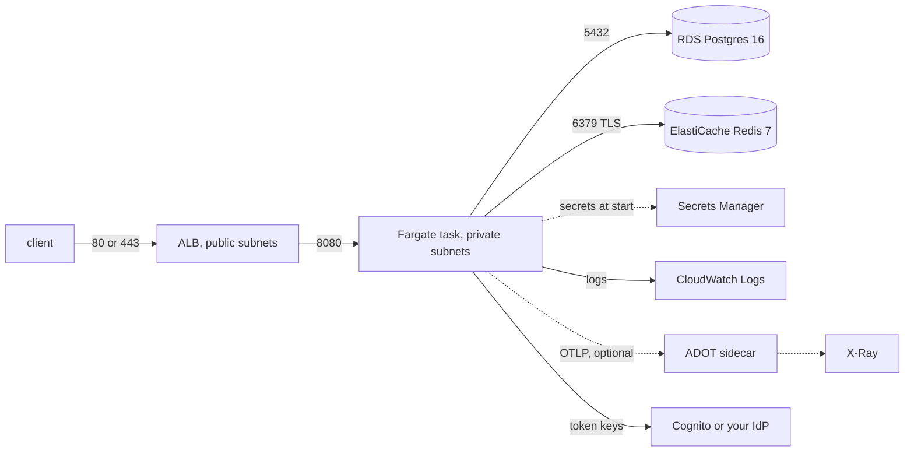

# Keystone on AWS (reference deployment)

This directory runs Keystone on ECS Fargate behind an ALB, with RDS Postgres and ElastiCache Redis.
It is a reference to read and to demo from, not a production blueprint. It has not been applied
yet: there are no AWS credentials on the machine that wrote it (see "What is verified").



## What it creates

| File | Resources |
|---|---|
| `network.tf` | VPC, 2 public and 2 private subnets in 2 AZs, internet gateway, one NAT gateway, security groups (ALB, task, data) |
| `alb.tf` | ALB, target group on `/healthz`, HTTP listener, HTTPS listener when `acm_certificate_arn` is set |
| `ecs.tf` | ECR repository, ECS cluster, task definition, service, log group, optional ADOT sidecar |
| `data.tf` | RDS Postgres 16 `db.t4g.micro` (20 GB gp3, encrypted), ElastiCache Redis 7 `cache.t4g.micro` (TLS, encrypted) |
| `secrets.tf` | Generated database passwords and the vault key, stored in Secrets Manager |
| `iam.tf` | Execution role and task role |
| `cognito.tf` | Optional user pool, groups and app clients (`enable_cognito`) |

## Use

```bash
cd deploy/terraform/aws
cp terraform.tfvars.example terraform.tfvars   # edit; no secrets go in it
terraform init
terraform apply -target=aws_ecr_repository.keystone   # the repository first, so there is somewhere to push
# build and push the image (from the repository root)
aws ecr get-login-password | docker login --username AWS --password-stdin "$(terraform output -raw ecr_repository_url | cut -d/ -f1)"
docker build -t "$(terraform output -raw ecr_repository_url):latest" --platform linux/amd64 ../../..
docker push "$(terraform output -raw ecr_repository_url):latest"
terraform apply
terraform output keystone_url
```

`make tf-plan` runs `init`, `validate` and `plan` with `terraform.tfvars.example`.

The default image is built without the scanner model (3.1 GB with it, 401 MB without, see the
Dockerfile), so `scanner_classifier` defaults to `none` and the scanner runs on its rules alone.

## Destroy it after the demo

**Run `terraform destroy` when you are done.** The stack costs money every hour it exists, whether
or not anyone calls it. The NAT gateway, the ALB, the database and the cache bill by the hour.
Check afterwards that the ECR repository, the log group and the secrets are gone: `terraform
destroy` removes them (the repository with `force_delete`, the secrets without a recovery window).

## Cost estimate

From the public us-east-1 list prices, for one task and the default sizes. These are estimates, not
measured bills; a day of traffic adds a little for data transfer and logs.

| Item | Per day |
|---|---|
| Fargate, 1 vCPU and 2 GB | $1.19 |
| NAT gateway | $1.08 |
| ALB (fixed part plus a small load) | $0.73 |
| RDS `db.t4g.micro` and 20 GB | $0.46 |
| ElastiCache `cache.t4g.micro` | $0.38 |
| Public IPv4 addresses (2 for the ALB, 1 for the NAT) | $0.36 |
| Secrets Manager (5 secrets) | $0.07 |
| **Total** | **about $4.30 per day, about $130 per month** |

Cognito is free for the first 10,000 monthly active users. The ADOT sidecar adds a few cents of
Fargate time when you turn it on, plus X-Ray's own charges.

## Choices and limits

- **The sandbox is off.** `KEYSTONE_SANDBOX_ENABLED=false`. The sandbox starts a container for each
  `run_code` call through the Docker socket, and Fargate gives a task no socket and no privileged
  mode. The `sandbox` upstream is not served, and the containerized stdio upstreams cannot start either.
  Running code on AWS would need a separate service (a Lambda or a second ECS task per call), which
  this stack does not build.
- **Without a certificate the stack runs in dev mode.** With no `acm_certificate_arn` the ALB serves
  plain HTTP, and Keystone in prod refuses an http public URL and identity provider, so the task
  runs with `KEYSTONE_ENV=dev`. Tokens cross the internet in the clear. That is a trial from your
  own address (`ingress_cidrs`), not a deployment: prod needs the certificate. Dev mode here
  relaxes the https rule. The other things `KEYSTONE_ENV` changes do not reach this stack: the
  audit log is pinned to fail closed, sign-in stays `oidc`, and the vault key is generated, so the
  prod-only refusal of the published development key has nothing to refuse.
  With a certificate, `terraform plan` refuses an http `public_base_url` or `oidc_issuer` instead
  of letting the service crash-loop at startup.
- **Secrets are in the state.** Terraform generates the passwords and the vault key, so they sit in
  `terraform.tfstate` as well as in Secrets Manager. The state stays local here. Use an encrypted S3
  backend with locking before sharing it.
- **Redis has no AUTH token.** Traffic is encrypted and the security group admits only the task.
- **One NAT gateway, one task, no Multi-AZ database.** A second of each is the first change for
  production.
- **The task role holds nothing** except X-Ray write access when `enable_adot` is on. Keystone
  calls no AWS API. The execution role may pull from this ECR repository, write this log group and
  read the five secrets.
- **The ADOT sidecar** uses the collector's bundled `ecs-xray.yaml`, and Keystone sends OTLP/HTTP to
  `localhost:4318` (the containers share a network namespace). I have not run it.

### Cognito instead of Keycloak

`enable_cognito` creates a user pool with the groups `admins`, `approvers`, `operators` and
`support`, three confidential clients (`support-agent`, `ops-agent`, `keystone-cli`, password
sign-in) and the public `console` client (authorization code flow), as in
`deploy/keycloak/realm-keystone.json`. Two things do not carry over:

- Keycloak's mappers add the `tenant` claim and a `roles` claim and an `aud` of `keystone`. Cognito
  adds none of them without a pre-token-generation Lambda, which this stack does not include. Until
  one exists, `oidc_audience` is set to the console client's id, so only the console's ID tokens
  validate, and tenants and roles do not resolve.
- Users are not created. Add them in the console or with `aws cognito-idp admin-create-user`.

To use another identity provider, leave `enable_cognito` false and set `oidc_issuer` and
`oidc_audience`.

## What is verified

| Check | Where | Status |
|---|---|---|
| `terraform fmt -check`, `validate`, `tflint` | CI job `terraform`, on changes under this directory | passes in CI |
| No secret values in `.tf` files | `tests/unit/test_terraform_files.py` | passes |
| `terraform plan` with the example variables | `make tf-plan` | deferred: needs AWS credentials |
| `terraform apply` and a call through the ALB | | not run |
