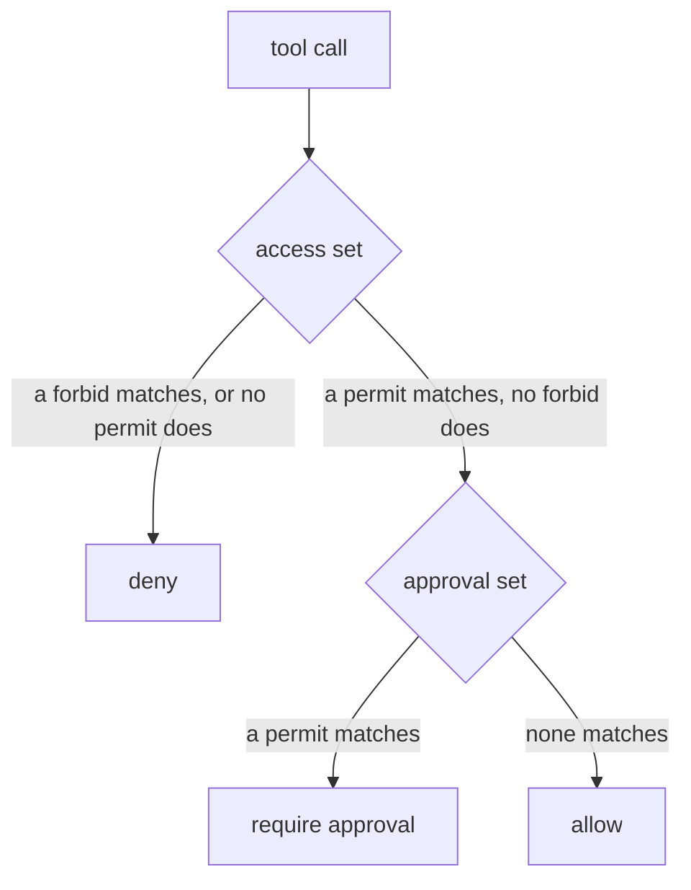

# Policies

Keystone decides every tool call and every tool listing with [Cedar](https://www.cedarpolicy.com)
policies kept in files. This page says how a decision is made, what a policy can read, shows five
policies to copy, and lists the mistakes that come up most. Settings and commands are in
`docs/runbook.md` (the Policies section).

## How a decision is made

Two sets of policies are asked in order, and the answer is one of three: allow, deny, or require
approval.



- **The access set** is standard Cedar. A call is denied unless some `permit` matches and no
  `forbid` does. The reasons of a deny are the `@id` of the forbids that matched, or
  `default-deny` when nothing allowed the call.
- **The approval set** is asked only when access allowed, and holds `permit` policies only. If one
  matches, the call needs a person's approval, and the matching ids are the reasons. If none
  matches, the call is allowed, and the reasons are the access permits that allowed it. Until
  Phase 6 the approval step refuses such a call, so it does not run.
- **A tool listing** stops after the access set. A tool the caller may not use is not listed, and
  a tool that needs approval still is.
- **Everything else is a deny.** A policy that fails to evaluate in either pass, a context the
  schema refuses, a tenant with no policies, or any exception gives a deny with the reason
  `policy-error`, and the cause goes to the log. Cedar skips a policy that errors, so without this
  rule a broken `forbid` would not forbid. With no rule that allows anything, every call is denied
  (`default-deny`).

Every policy needs `@id("kebab-case-name")`. The id is what the audit log shows as the reason, so
a decision can be read by a person. Ids are unique within a tenant's rules, and `default-deny`,
`policy-error` and `no-decision` are taken.

## Where the files go

```
policies/
  schema.cedarschema          the one schema
  default/access/*.cedar      rules for every tenant
  default/approval/*.cedar
  demo/access/*.cedar         the demo upstreams' rules; read when policy.include_demo is on
  demo/approval/*.cedar
  acme/approval/*.cedar       rules for the tenant with the id acme
  acme/access/*.cedar
```

A tenant's access set is `default/` plus `demo/` (if on) plus its own directory, and so is its
approval set. A rule that every tenant needs goes in `default/`. A directory or file Keystone
would never read, such as `aproval/` or `base.cdar`, stops the load, because a rule that does not
load is a rule someone believes is in force.

## What a policy can read

### Entities

| Name | Attributes | Member of |
|---|---|---|
| `Keystone::User::"<tenant>:<user>"`, the caller | `tenant` | `Keystone::Group::"<group>"` for each of the caller's groups |
| `Keystone::Tool::"<name>"`, for example `bank__transfer` | `tenant`, `risk` (`"low"`, `"medium"`, `"high"`, `"critical"`), `risk_level` (1 to 4), `tags` (a set of strings) | `Keystone::Upstream::"<id>"` |
| `Keystone::Upstream::"<id>"` | `tenant` | |

The user id includes the tenant, so one user id in two tenants is two users. Actions are
`Keystone::Action::"call_tool"` and `Keystone::Action::"list_tool"`. Tags are `reads_untrusted`,
`reads_sensitive`, `external_effect` and `code_exec`.

### Context

| Field | Type | Meaning |
|---|---|---|
| `agent_id` | String | The agent the caller works through |
| `agent_trust` | String | `"low"`, `"standard"` or `"high"`, from the agent config |
| `session_flags` | Set of String | Tool tags the session has touched (Phase 7) |
| `session_tainted` | Bool | Whether the session read something untrusted (Phase 7) |
| `call_count` | Long | Calls made in the session |
| `hour_utc` | Long | The hour of the call, 0 to 23 |
| `args` | record | Facts extracted from the call's arguments: `amount`, `recipient_domain`, `path`, `count`, each optional |

A listing has no session, so `session_flags` is empty, `session_tainted` is false and
`call_count` is 0 there.

`args` holds only what the tool's `extract` config asks for. `extract: {amount: "$.amount |
cents"}` on the transfer tool makes `context.args.amount` the amount in cents. Because an argument
can be missing or unreadable, every field of `args` is optional, and a policy must test it with
`has` before reading it. The runbook lists the pipes (`int`, `cents`, `domain`, `lower`, `len`).

## Five policies to copy

Each of these validates against the schema, which a test checks.

**1. Let a group use one upstream, up to high risk.** `finance` may list and call the bank tools,
but only inside its own tenant.

```cedar
@id("finance-uses-the-bank")
permit (
  principal in Keystone::Group::"finance",
  action in [Keystone::Action::"list_tool", Keystone::Action::"call_tool"],
  resource in Keystone::Upstream::"bank"
)
when { resource.tenant == principal.tenant && resource.risk_level <= 3 };
```

**2. Keep a tool closed at night.** A `forbid` beats every permit, so this holds whatever else
allows the call.

```cedar
@id("no-transfers-at-night")
forbid (
  principal,
  action == Keystone::Action::"call_tool",
  resource == Keystone::Tool::"bank__transfer"
)
when { context.hour_utc < 6 || context.hour_utc >= 20 };
```

**3. Ask for approval above a limit.** This is the demo rule in `policies/demo/approval/bank.cedar`.
The transfer tool's extractor gives the amount in cents, so 500 is 50000. A transfer of exactly 500
goes through, and one of 500.01 asks. When the amount could not be read, the rule asks as well: a
rule that stays silent when it does not know lets the unusual call through.

```cedar
@id("approve-transfer-over-500")
permit (
  principal,
  action == Keystone::Action::"call_tool",
  resource == Keystone::Tool::"bank__transfer"
)
when { if context.args has amount then context.args.amount > 50000 else true };
```

**4. Ask for approval of mail to other domains.** This is acme's rule in
`policies/acme/approval/mail.cedar`. The domain is missing when the recipient is not one plain
address (two recipients, a display name), and a missing domain counts as outside. The rule names
the tool; without that, "no domain" would be true of every other tool and send all of them to
approval.

```cedar
@id("external-email-needs-approval")
permit (
  principal,
  action == Keystone::Action::"call_tool",
  resource == Keystone::Tool::"mail__send_email"
)
when { if context.args has recipient_domain then context.args.recipient_domain != "acme.test" else true };
```

**5. Give an untrusted agent no side effects.** An agent that is not listed in the config gets the
trust `low` when `auth.allow_unknown_agents` is on. This keeps it from any tool tagged
`external_effect`, whoever the user is.

```cedar
@id("low-trust-agents-have-no-side-effects")
forbid (principal, action == Keystone::Action::"call_tool", resource)
when { context.agent_trust == "low" && resource.tags.contains("external_effect") };
```

## Testing policies

A policy change is checked like code. Cases in `tests/policy_cases/*.yaml` say who calls what and
which decision the policies must give, and `keystone policy test` runs them through the same
loader and engine the gateway uses:

```yaml
# a policy case
- name: support cannot transfer
  tenant: acme
  principal: {user: alice, groups: [support], agent: support-agent, trust: standard}
  tool: {name: bank__transfer, risk: high, tags: [external_effect]}
  args: {amount: 90000}
  session: {flags: [], tainted: false}
  expect: deny
  expect_reasons: [default-deny]
```

`args` are the facts a policy reads (`context.args`), as the extractors give them: cents for the
transfer tool. To test the extractors with the policies, give the call's own `arguments` and the
tool's `extract` instead, as the cases for the transfer and mail rules do. `expect_reasons` is
optional. A case can also set `action: list_tool`, `tool.tenant` (a tool of another tenant), the
`hour` (0 to 23), the session's `call_count`, and the principal's `roles`. A key that is not in
this list is an error, so a typo cannot weaken a case.

```bash
uv run keystone policy test policies tests/policy_cases --coverage
```

It prints one row per case and exits 1 if any case decides differently, or the policies or the
cases cannot be read. `--coverage` also lists every policy that no case matched, and fails: a
policy is matched when it is among the reasons of a decision. The `policy` job of CI runs this on
every push, so a pull request that flips a decision fails there, naming the case, and a rule added
without a case is listed. The shipped cases are in `tests/policy_cases/`.

## Reloading

Edit the files, then `keystone policy reload` (or `POST /admin/api/v1/policies/reload`, or SIGHUP
to the process). A set with any problem is refused with every problem named, and the rules in
force stay in force. The version of the set in force is the sha256 of its files, and every audit
record names it.

## Common mistakes

**Reading a field of `args` without `has`.** The validator refuses it, because the field may be
missing. The load fails and names the file and the policy.

```cedar-error
@id("amount-over-limit")
permit (principal, action == Keystone::Action::"call_tool", resource)
when { context.args.amount > 50000 };
```

Write `context.args has amount && context.args.amount > 50000`, or the `if ... then ... else`
form of example 3 when "unknown" should be treated as a yes.

**Comparing a number with text.** `amount` is a Long. Compare it with `50000`, not `"50000"`.

```cedar-error
@id("amount-as-text")
permit (principal, action == Keystone::Action::"call_tool", resource)
when { context.args has amount && context.args.amount > "50000" };
```

**Writing a limit in the wrong unit.** This loads, and it asks for approval above 500 cents, which
is 5.00, because the extractor gives cents. Check the extractor of the tool before you write a
number.

```cedar-mistake
@id("approve-transfer-over-500")
permit (principal, action == Keystone::Action::"call_tool", resource == Keystone::Tool::"bank__transfer")
when { context.args has amount && context.args.amount > 500 };
```

**A rule that is silent when it does not know.** `has amount && ...` is false when the amount is
missing, so a transfer whose amount could not be read is not asked about. For a limit, prefer the
`if ... else true` form.

**A `forbid` in the approval set.** The approval set can ask for approval and cannot block, so a
forbid there is refused when the files load. Put it in `access/`.

```cedar-error
// approval/block-everything.cedar
@id("block-everything")
forbid (principal, action, resource);
```

**A permit that forgets the tenant.** `permit (principal in Keystone::Group::"finance", action,
resource)` would let finance use another tenant's tools if one ever appeared. The default pack
ends with `deny-cross-tenant`, a forbid that covers this, but a permit should still say
`resource.tenant == principal.tenant`.

**A group tested with `==`.** A user is in a group through `principal in Keystone::Group::"x"`. A
group is not a principal, so `principal == Keystone::Group::"x"` is refused when the files load.

```cedar-error
@id("group-by-equality")
permit (principal == Keystone::Group::"finance", action, resource);
```

**Expecting a listing to see the session.** `list_tool` has no session, so a policy that reads
`context.session_tainted` for `list_tool` sees `false`. Use `call_tool` for rules about the
session.

**A rule in `default/` for one tenant.** Everything in `default/` applies to every tenant. A rule
for one tenant goes in the directory named for it.
